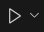
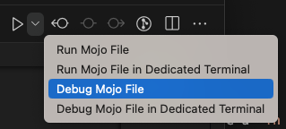
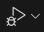
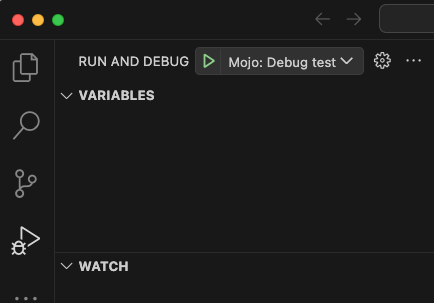
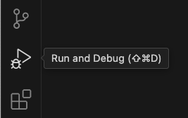
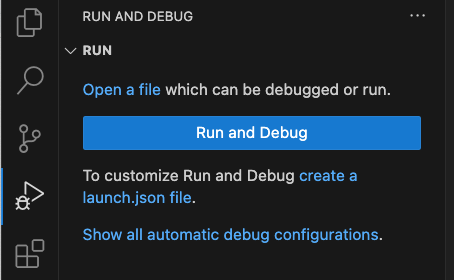
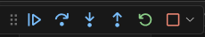
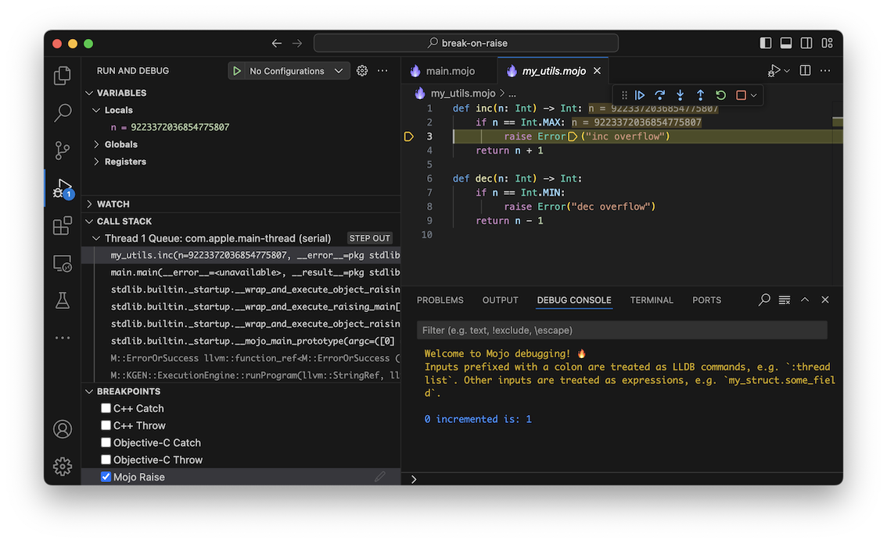
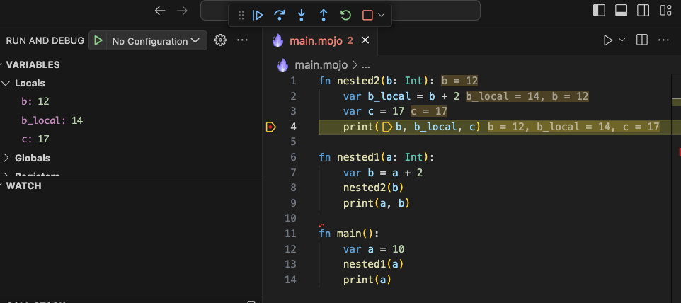
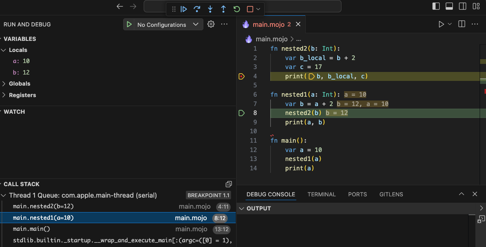

Visual Studio Code 的 Mojo 扩展使你能够在 Mojo 代码中使用 VS Code 内置的调试器。本页介绍了 VS Code Mojo 扩展提供的功能以及 Mojo 调试器目前的限制。

你可以从 [Visual Studio Code Marketplace](https://marketplace.visualstudio.com/items?itemName=modular-mojotools.vscode-mojo) 或 [Open VSX Registry](https://open-vsx.org/extension/modular-mojotools/vscode-mojo) 安装 Mojo 扩展。

要使用 Mojo 扩展，你还必须[安装 `mojo` 包](/install/)——或者，如果你正在为 MAX 框架开发，[安装 `modular` 包](/max/packages)，其中包含 `mojo` 包。

:::note

Mojo 扩展依赖 Python 扩展来定位你的 Python 环境。在某些情况下，即使存在虚拟环境，它似乎也会默认使用全局安装的环境。如果 Mojo 扩展找不到你的 SDK 安装，请尝试调用"Python: Set Project Environment"命令并选择你的虚拟环境。

:::

有关 VS Code 调试功能的完整介绍，请参阅 [Visual Studio Code 中的调试](https://code.visualstudio.com/docs/editor/debugging)。

`mojo` 包包含 [LLDB 调试器](https://lldb.llvm.org/)和 Mojo LLDB 插件。它们共同为 Mojo 扩展提供底层调试接口。你也可以使用 `mojo debug` 命令启动使用 LLDB 的命令行调试会话，或在 VS Code 中启动 Mojo 调试会话。

`mojo` 包还支持调试在 GPU 上运行的 Mojo 程序。这需要一些额外的软件和配置。目前 GPU 调试仅适用于 NVIDIA GPU。详情请参见 [GPU 调试](/docs/tools/gpu-debugging/)。

## 开始调试

在 VS Code 中有多种启动调试会话的方式。

要开始调试，你需要有一个 Mojo 项目来调试。[我们的 GitHub 仓库](https://github.com/modular/modular/tree/main/mojo/examples)中有许多从简单到复杂的示例。

:::note[VS Code 老手？]

如果你已经熟悉 VS Code 中的调试，本节内容大部分是复习。你可能想直接跳到[启动配置](#launch-configurations)或查看[使用调试器](#using-the-debugger)了解 Mojo 调试器支持的功能说明。

:::

### 快速运行或调试

如果你的活动编辑器标签页中包含带有 `def main()` 入口的 Mojo 文件，运行或调试它最快的方式之一是使用编辑器工具栏中的**运行或调试**按钮。



要开始调试当前文件：

- 打开**运行或调试**下拉菜单，选择**Debug Mojo File**或**Debug Mojo File in Dedicated Terminal**。

  

这两种调试配置在处理输入和输出方面有所不同：

- **Debug Mojo File** 在不附加任何终端的情况下启动 Mojo 程序。程序的标准输出和标准错误输出显示在**调试控制台**中。你无法写入程序的标准输入，但你可以在一个位置查看程序的输出并与调试器交互。

- **Debug Mojo File in Dedicated Terminal** 创建一个新的 VS Code 集成终端实例，并将程序的输入和输出附加到该终端。这让你可以在终端中与程序的标准输入、标准输出和标准错误输出交互，而**调试控制台**仅用于与调试器交互。

**运行或调试**按钮使用预定义的启动配置。目前无法修改使用**运行或调试**配置启动的程序的 `args`、`env`、`cwd` 或其他设置。如果你需要自定义这些内容，请参见[编辑启动配置](#edit-launch-configurations)。

选择一种调试配置后，按钮会更新为显示调试符号。点击按钮可重新运行之前的配置。

.

### 运行和调试视图

**运行和调试**视图包含启动调试会话的按钮和选择调试配置的菜单。它还有显示当前变量、监视表达式、当前调用栈和断点的区域。

<figure>



<figcaption><b>图 1.</b> 运行和调试视图</figcaption>
</figure>

要打开**运行和调试**视图，点击 VS Code 窗口左侧**活动栏**中的**运行和调试**图标，或按 <kbd>Control+Shift+D</kbd>（macOS 上为 <kbd>Command+Shift+D</kbd>）。



如果你在当前项目中没有创建任何启动配置，VS Code 会显示**运行起始视图**。

<figure>



<figcaption><b>图 2.</b> 运行起始视图</figcaption>
</figure>

如果你已经启动过调试会话或创建了 `launch.json` 文件来定义启动配置，你会看到**启动配置**菜单，让你选择配置并启动调试会话：

<figure>


<figcaption><b>图 3.</b> 启动配置菜单</figcaption>
</figure>

### 其他启动调试会话的方式

还有许多其他启动调试会话的方式。

#### 从命令面板启动

如果你的活动编辑器中打开了 Mojo 文件，你也可以从**命令面板**启动调试会话。

1. 点击**视图** > **命令面板**或按 <kbd>Control+Shift+P</kbd>（macOS 上为 <kbd>Command+Shift+P</kbd>）。

2. 在提示符处输入"Mojo"以调出 Mojo 命令。你应该能看到[快速运行或调试](#quick-run-or-debug)中描述的相同调试配置。

#### 从文件资源管理器启动

要从**文件资源管理器**视图启动调试会话：

1. 右键点击 Mojo 文件。
2. 选择一个 Mojo 调试配置。

你应该能看到[快速运行或调试](#quick-run-or-debug)中描述的相同调试配置。

#### 使用 F5 调试

按 F5 使用当前调试配置启动调试会话。

如果你没有任何可选择的现有调试配置，且活动编辑器中包含带有 `def main()` 入口的 Mojo 文件，按 F5 将使用[快速运行或调试](#quick-run-or-debug)中描述的**Debug Mojo File**操作启动并调试当前文件。

## 从命令行启动调试器

使用 `mojo debug` 命令从命令行启动调试会话。你可以选择两种调试界面：

- 使用 `--vscode` 标志，如果 VS Code 正在运行且 Mojo 扩展已启用，`mojo debug` 会在 VS Code 中启动调试会话。

- 不使用 `--vscode` 标志，`mojo debug` 启动命令行 [LLDB 调试器](https://lldb.llvm.org/)会话。

你可以选择构建并调试 Mojo 文件、运行并调试已编译的二进制文件，或将调试器附加到正在运行的进程。

:::note[环境变量]

当你使用 `--vscode` 从命令行调试程序时，程序使用终端中设置的环境变量运行。当从 VS Code 内部通过 GUI 启动时，环境由 VS Code [启动配置](#launch-configurations)定义。

:::

有关命令行选项的完整列表，请参见 [`mojo debug` 参考页面](/docs/cli/debug)。

### 从命令行启动调试会话

在 VS Code 打开的情况下，运行以下命令（从 VS Code 的集成终端或外部 shell）：

```bash
mojo debug --vscode myproject.mojo
```

或者调试已编译的二进制文件：

```bash
mojo debug --vscode myproject
```

为获得最佳结果，在构建你打算调试的二进制文件时，请使用 `-O0 -g` 命令行选项——这会生成包含完整调试信息的二进制文件。（当你对 Mojo 源文件调用 `mojo debug` 时，默认包含调试信息。）有关编译选项的详情，请参见 [`mojo build` 参考页面](/docs/cli/build/)。

### 从命令行将调试器附加到正在运行的进程

你也可以通过在命令行上指定进程 ID 或进程名称来将调试器附加到正在运行的进程：

```bash
mojo debug --vscode --pid <PROCESS_ID>
```

或者：

```bash
mojo debug --vscode --process-name <PROCESS_NAME>
```

## 启动配置

VS Code *启动配置*让你定义调试应用程序的设置信息。

Mojo 调试器提供以下启动配置模板：

- 调试当前 Mojo 文件。启动并调试活动编辑器标签页中的 Mojo 文件。实际上与[快速运行或调试](#quick-run-or-debug)中描述的**Debug Mojo File**操作相同，但有更多配置选项。

- 调试 Mojo 文件。与前一项类似，不同之处在于它指定一个特定文件来启动和调试，无论活动编辑器中显示的是什么文件。

- 调试二进制文件。此配置操作预构建的二进制文件，可以是 LLDB 支持的任何语言混合（Mojo、C、C++ 等）。你需要将 `program` 字段设置为二进制文件的路径。

- 附加到进程。启动一个附加到正在运行进程的调试会话。启动时，你可以从正在运行的进程列表中选择要调试的进程。

你可以编辑任何这些模板来自定义它们。所有 VS Code 启动配置必须包含以下属性：

- `name`。启动配置的名称，显示在 UI 中（例如"Run current Mojo file"）。
- `request`。可以是 `launch`（从 VS Code 运行程序）或 `attach`（附加到并调试正在运行的文件）。
- `type`。Mojo 调试器使用 `mojo-lldb`。GPU 调试使用 `mojo-cuda-gdb`。

此外，Mojo 启动配置可以包含以下属性：

- `args`。传递给程序的任何命令行参数。
- `cwd`。运行程序的当前工作目录。
- `description`。配置的较长描述，不在 UI 中显示。
- `env`。运行程序前要设置的环境变量。
- `mojoFile`。要启动和调试的 Mojo 文件路径。
- `pid`。要附加到的正在运行进程的进程 ID。
- `program`。要启动和调试的已编译二进制文件路径，或要附加到的程序。
- `runInTerminal`。设为 True 以使用专用终端运行程序，允许程序从终端接收标准输入。设为 False 以将程序输出定向到**调试控制台**。

Mojo GPU 启动配置可以包含以下属性：

- `breakOnLaunch`。设为 true 以在 GPU 内核启动时自动中断。

- `initCommands`。启动时向调试器发出的命令数组。要使用经典 CUDA-GDB 调试器后端，请在配置中添加以下行：

  ```json
  "initCommands": [
      "set environment CUDBG_USE_LEGACY_DEBUGGER=1"
  ],
  ```

- `legacyDebugger`。设为 true 以使用经典调试器后端。

如果配置是 `launch` 请求，配置必须包含 `mojoFile` 或 `program` 属性。

对于 `attach` 请求，配置必须包含 `pid` 或 `program` 属性。

VS Code 会对启动配置执行变量替换。你可以使用 `${workspaceFolder}` 替换当前工作区的路径，使用 `${file}` 表示活动编辑器标签页中的文件。有关变量的完整列表，请参见 VS Code [变量参考](https://code.visualstudio.com/docs/editor/variables-reference)。

更多信息请参见 VS Code 文档中的[启动配置](https://code.visualstudio.com/docs/editor/debugging#_launch-configurations)。

:::note[编译选项]

Mojo 启动配置不允许你指定编译选项。如果你需要指定编译选项，可以使用 [`mojo build`](/docs/cli/build) 构建二进制文件，然后使用带有 `program` 选项的启动配置来启动已编译的二进制文件。或者，如果你[从命令行启动调试器](#starting-the-debugger-from-the-command-line)，你可以将编译选项传递给 `mojo debug` 命令。

:::

### 编辑启动配置

要编辑启动配置：

1. 如果**运行和调试**视图尚未打开，点击 VS Code 窗口左侧**活动栏**中的**运行和调试**图标，或按 <kbd>Control+Shift+D</kbd>（macOS 上为 <kbd>Command+Shift+D</kbd>）。

   

2. 创建或打开 `launch.json` 文件：
   1. 如果你看到**运行起始视图**，点击**create a launch.json file**。
   2. 如果你已经设置了启动配置，点击**启动配置**菜单旁边的齿轮图标。
      

3. 从调试器列表中选择**Mojo**。

VS Code 会在编辑器标签页中打开新的 `launch.json` 文件，其中包含一些常见调试操作的模板。点击**添加配置**以添加新的配置模板。

## 使用调试器

当调试会话运行时，使用调试工具栏暂停、继续和单步执行程序。



工具栏上的按钮有：

- **继续/暂停**：如果程序已停止，恢复程序的正常执行直到下一个断点、信号或崩溃。否则，同时暂停程序的所有线程。

- **单步跳过**：执行下一行代码，不在函数调用处停止。

- **单步进入**：执行下一行代码并在第一个函数调用处停止。如果程序刚好停在函数调用之前，则进入函数以便你逐行单步执行。

- **单步跳出**：完成当前函数的执行，在返回到父函数后立即停止。

- **重新启动**：如果是 `launch` 会话，终止当前程序并重新启动调试会话。否则，从目标进程分离并重新附加。

- **停止**：如果是 `launch` 会话，终止当前程序。否则，从目标进程分离而不终止它。

调试器目前有以下限制：

- 不支持在 Mojo 错误上自动中断。

- 跳出函数时，不显示返回值。

- LLDB 不支持停止或恢复单个线程。

### 断点

Mojo 调试器支持设置[标准断点](https://code.visualstudio.com/docs/editor/debugging#_breakpoints)、[日志断点](https://code.visualstudio.com/docs/editor/debugging#_logpoints)、[函数断点](https://code.visualstudio.com/docs/editor/debugging#_function-breakpoints)、[数据断点](https://code.visualstudio.com/docs/editor/debugging#_data-breakpoints)和[触发断点](https://code.visualstudio.com/docs/editor/debugging#_triggered-breakpoints)，如 VS Code 文档中所述。Mojo 调试器还支持*错误断点*（也称为"break on raise"），每当执行 `raise` 语句时就会中断。

调试 Mojo 代码时，调试器不支持基于表达式的条件断点（它确实支持命中次数，VS Code 将其归类为一种条件断点）。

编辑断点时，你会看到四个选项：

- **Expression**。设置条件断点（目前不支持）。
- **Hit Count**。为断点添加命中次数（支持）。
- **Log Message**。添加日志断点（支持）。
- **Wait for Breakpoint**。添加触发断点（支持）。

#### 设置命中次数断点

命中次数断点是一种只有在调试器命中指定次数后才会中断执行的断点。

要添加命中次数断点：

1. 在编辑器左侧边栏中你想放置断点的位置右键点击，选择**Add Conditional Breakpoint.**
2. 从菜单中选择**Hit Count**并输入所需的命中次数。

要将现有断点更改为命中次数断点：

1. 在编辑器左侧边栏中右键点击断点，选择**Edit breakpoint**。
2. 从菜单中选择**Hit Count**并输入所需的命中次数。

你也可以从**运行和调试**视图的**断点**部分编辑断点：

- 右键点击断点并选择**Edit Condition**，或者
- 点击断点旁边的**Edit Condition**图标。

这会调出相同的菜单，**在编辑器标签页的断点旁边**。

#### 启用错误断点

你可以在 VS Code 中通过在**运行和调试**视图的**断点**部分选择"Mojo Raise"来启用和禁用错误断点。如果在调试期间启用，执行 `raise` 语句会导致调试器停止执行并高亮显示引发错误的代码行。



### 查看局部变量

当程序在调试器中暂停时，编辑器会内联显示局部变量值。你也可以在**运行和调试**视图的**变量**部分找到它们。

<figure>



<figcaption><b>图 4.</b> 调试器中显示的局部变量值</figcaption>
</figure>

### 查看调用栈

当程序在调试器中暂停时，**运行和调试**视图显示当前调用栈。（你可能会看到多个调用栈，程序中每个活动线程一个。）

<figure>



<figcaption><b>图 5.</b> 运行和调试视图中的调用栈</figcaption>
</figure>

**运行和调试**视图的**调用栈**部分为当前调用栈中的每个函数调用显示一个栈帧。点击函数名会高亮显示该函数中的当前行。例如，在图 5 中，程序在 `nested2()` 中的断点处暂停，但调用栈中选择了父函数 `nested1()`。编辑器高亮显示 `nested1()` 中的当前行（即对 `nested2()` 的调用），并显示 `nested1()` 的当前局部变量值。

### 使用调试控制台

**调试控制台**为你提供了调试器的命令行界面。**调试控制台**处理 LLDB 命令和 Mojo 表达式。

任何以冒号（`:`）为前缀的内容都被视为 LLDB 命令。任何其他输入都被视为表达式。

目前 Mojo 表达式仅限于检查变量及其字段。控制台还支持标准库中某些数据结构的下标表示法（`vector[index]`），包括 `List` 和 `SIMD`。

未来，我们打算提供一种方式让任意数据结构在**调试控制台**中支持下标表示法。

:::note

**调试控制台**仅在程序暂停时接受输入。

:::

## 技巧和窍门

标准库中有一些与调试器不直接相关但可以帮助你调试程序的功能，包括：

- 编程式断点。
- 从 Mojo 命令行设置参数。

### 设置编程式断点

要在代码中的特定位置中断，你可以使用内置的 [`breakpoint()`](/docs/std/builtin/breakpoint/breakpoint/) 函数：

```mojo
if some_value.is_valid():
   do_the_right_thing()
else:
   # 我们永远不应该到达这里！
   breakpoint()
```

如果你在 VS Code 中打开并以调试模式运行此代码（使用 VS Code 或 `mojo debug`），命中 `breakpoint()` 调用会产生一个错误，从而触发调试器。

:::note[断言]

[`testing`](/docs/std/testing/testing/) 模块包含多种指定断言的方式。断言也会触发错误，因此可以像 `breakpoint()` 调用一样打开调试器。

:::

### 从 Mojo 命令行设置参数

你可以使用 [`sys`](/docs/std/sys/) 模块检索在 Mojo 命令行上指定的参数值。除其他用途外，这是一种轻松开关调试逻辑的方式。例如：

```mojo
from std.sys import is_defined

def some_function_with_issues():
    # ...
    comptime if is_defined["DEBUG_ME"]():
        breakpoint()
```

要激活此代码，使用 [`-D` 命令行选项](/docs/cli/debug#compilation-options)定义 `DEBUG_ME`：

```bash
mojo debug -D DEBUG_ME main.mojo
```

`is_defined()` 函数根据指定名称是否已定义返回编译时的 true 或 false 值。由于 `breakpoint()` 调用在 [`comptime if` 语句](/docs/manual/metaprogramming/comptime-evaluation/#comptime-if)内，只有当 `DEBUG_ME` 名称在命令行上定义时，它才会被包含在编译后的代码中。

## 故障排除

### `error: can't connect to the RPC debug server socket`

如果使用 `mojo debug --vscode` 时出现消息 `error: can't connect to the RPC debug server socket: Connection refused`，请尝试以下可能的修复方法：

- 确保 VS Code 已打开。
- 如果 VS Code 已打开，尝试重启 VS Code。
- 如果有其他 VS Code 窗口打开，尝试关闭它们然后重启。此错误有时会在多个窗口以特定顺序打开和关闭时发生。

### `error: couldn't get a valid response from the RPC server`

如果使用 `mojo debug --vscode` 时出现消息 `error: couldn't get a valid response from the RPC server`，请尝试以下可能的修复方法：

- 确保 VS Code 打开的是一个有效的 Mojo 代码库。此错误有时会在 VS Code 窗口打开的是其他代码库时发生。
- 如果有多个 VS Code 窗口打开，尝试关闭除你要调试的窗口之外的所有窗口。
- 重启 VS Code。
- 重新安装 SDK 并重启 VS Code。
- 如果你正在使用开发版本的 SDK，确保所有 SDK 工具都已通过你的构建系统正确构建，然后重新加载 VS Code。
- 作为最后的手段，重启整个计算机可以解决此问题。

如果这些步骤没有帮助，请提交问题。我们非常希望你的帮助来识别可能的原因和修复方法！
